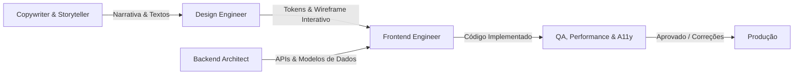

# Catálogo de Agentes Especializados de IA (Agents)
> **Equipe Virtual de Engenharia e Design para o Portfólio de Gustavo Fagundes**

Este diretório contém os perfis de **Agentes de IA em Markdown (`.md`)**. Cada agente possui uma especialidade clara, um conjunto estrito de responsabilidades, dependências documentadas e critérios rigorosos de aceitação.

---

## 👥 Matriz de Agentes

| Agente | Arquivo | Especialidade Principal | Quando Acionar |
| :--- | :--- | :--- | :--- |
| **Design Engineer** | [`design-engineer.agent.md`](file:///d:/projetos/gustavo-portfolio/agents/design-engineer.agent.md) | UI/UX, Design System Obsidian & Ice White, física de molas Apple, microinterações táteis, Bento Grid e glassmorphism. | Ao desenhar, refinar ou animar componentes visuais, layout e transições. |
| **Frontend Engineer** | [`frontend-developer.agent.md`](file:///d:/projetos/gustavo-portfolio/agents/frontend-developer.agent.md) | Implementação de código limpo, reatividade, gerenciamento de estado, i18n bilíngue (EN/PT) e responsividade. | Ao transformar especificações de design em código de componentes e páginas. |
| **Backend & Systems Architect** | [`backend-architect.agent.md`](file:///d:/projetos/gustavo-portfolio/agents/backend-architect.agent.md) | Modelagem de dados, arquitetura de cases, API de contato/agendamento, segurança e simulação de microsserviços (PIX/Redis). | Ao estruturar rotas de API, formulários de contato, endpoints e lógica de dados. |
| **QA, Performance & A11y** | [`qa-performance-a11y.agent.md`](file:///d:/projetos/gustavo-portfolio/agents/qa-performance-a11y.agent.md) | Orçamento de 60fps/120fps, GPU layers, auditoria WCAG 2.1 AA, prefers-reduced-motion e SEO estruturado. | Antes de aprovar qualquer feature, realizar code review ou auditar performance. |
| **Copywriter & Storyteller** | [`copy-storyteller.agent.md`](file:///d:/projetos/gustavo-portfolio/agents/copy-storyteller.agent.md) | Tom de voz, narrativa de cases de impacto (+1M PIX, 11 sistemas), microcopy bilíngue e conversão sem clichês. | Ao redigir ou revisar textos, headlines, estudos de caso e bios em EN e PT. |

---

## 🔄 Fluxo de Trabalho Integrado (Orquestração)

---

## 🛠️ Como Acionar um Agente via Chat / Prompt
Para invocar qualquer agente durante o desenvolvimento, mencione o nome do agente ou declare no início da instrução:
> *"Atuando como o agente [Nome do Agente] definido em `agents/[nome].agent.md`, execute a seguinte tarefa..."*
