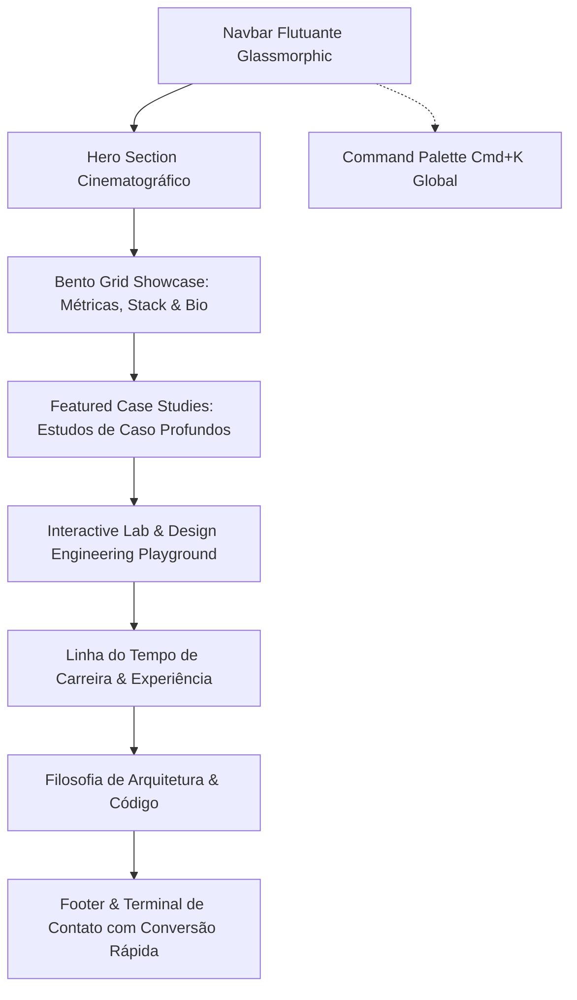

# 02. Arquitetura de Informação & Storytelling

## 1. Princípios de Navegação e Storytelling
A navegação do portfólio segue uma **narrativa progressiva de descoberta**:
1. **Primeiro Impacto (0-5s):** Apresentação clara de quem é Gustavo, seu nível de senioridade e o calibre dos projetos em que atua.
2. **Autoridade & Densidade Técnica (5-20s):** O Bento Grid sintetiza competências, métricas reais (+1M PIX, 11 sistemas) e domínio de stack sem sobrecarregar a leitura.
3. **Prova Concreta de Impacto (20-60s):** Os Estudos de Caso detalham desafios de arquitetura, decisões técnicas e soluções visuais.
4. **Interatividade & Domínio de UI (60-90s):** O Lab Interativo prova que o desenvolvedor domina a física de interfaces e a fluidez recomendada pela Apple.
5. **Conversão Imediata (Fim da jornada):** Canais de contato desobstruídos com agendamento de call e links diretos.

---

## 2. Mapa Estrutural da Página (Section Blueprint)

---

## 3. Detalhamento de Cada Bloco

### Bloco 1: Navbar Flutuante Glassmorphic
* **Posição:** Fixa no topo (`sticky top-4`), centralizada, com margem flutuante (`max-w-5xl mx-auto`).
* **Acabamento:** Fundo translúcido `rgba(10, 10, 10, 0.65)` com `backdrop-blur-md` e borda `1px solid rgba(255, 255, 255, 0.08)`.
* **Elementos:**
  * **Logo Monograma:** `GF` em tipografia monoespaçada com brilho sutil.
  * **Links de Âncora:** `#sobre`, `#cases`, `#lab`, `#trajetoria`, `#contato`.
  * **Status Badge:** Ponto verde pulsante com label dinâmico: *"Available for projects / Disponível para novos desafios"*.
  * **Language Switcher:** Toggle compacto `EN | PT` com transição instantânea de texto e ícone de globo minimalista.
  * **Botão CTA:** *"Let's Talk / Falar Comigo"* com microinteração de escala ao clique.

---

### Bloco 2: Hero Section Cinematográfico
* **Objetivo:** Estabelecer status de alto nível e capturar a atenção imediatamente.
* **Elementos Visuais:**
  * **Spotlight Mouse Follower:** Um foco de luz monocromático sutil (`radial-gradient`) que acompanha suavemente o cursor sobre o fundo Obsidian.
  * **Overline Pill:** Badge translúcido com o texto *"FULL STACK IV & DESIGN ENGINEER"*.
  * **Headline Principal:**
    * *EN:* "Crafting high-scale backend engines and fluid, Apple-grade digital interfaces."
    * *PT:* "Construindo arquiteturas de alta escala e interfaces fluidas de padrão mundial."
  * **Subheadline:** Síntese precisa de 5+ anos de experiência conectando microsserviços em PHP (Symfony/Laravel), .NET 8 e Node.js a interfaces fluidas em Vue 3, React e TypeScript.
  * **Ações Principais:**
    * Primário: *"View Case Studies / Ver Casos de Estudo"* (rolagem suave até os cases).
    * Secundário: *"Schedule Call / Agendar Reunião"* (modal ou link direto).
    * Terciário: Ícones de acesso rápido para GitHub e LinkedIn com indicador de tooltip tátil.

---

### Bloco 3: Bento Grid Showcase (Dribbble Trending Style)
A grade modular assimétrica organiza a biografia técnica em blocos intuitivos e de alta densidade informativa:

| Posição no Grid | Bloco | Conteúdo & Interatividade |
| :--- | :--- | :--- |
| **Col 1-2 (2x2)** | **Impacto em Escala** | Destaque numérico para **+1.000.000** de transações financeiras PIX processadas e **11** sistemas integrados sob liderança técnica. |
| **Col 3-4 (2x1)** | **Core Tech Stack** | Categorias com badges interativos: *Backend* (Symfony, Laravel, .NET 8, Node.js), *Frontend* (Vue 3, React, Next.js, Tailwind), *Data* (PostgreSQL, MySQL, Redis, Supabase). Ao passar o mouse, o ícone acende em Ice White. |
| **Col 3 (1x1)** | **Localização & Horário** | Relógio analógico/digital minimalista em tempo real exibindo o fuso de Aracaju, Brasil (UTC-3) e indicador de disponibilidade. |
| **Col 4 (1x1)** | **Terminal Snippet** | Mini console simulando execução de testes unitários ou build bem-sucedido com tipografia *JetBrains Mono*. |
| **Col 1-4 (4x1)** | **Certificações & Reconhecimento** | Destaque para a certificação **Claude 101 (Anthropic)** e formação em Análise e Desenvolvimento de Sistemas. |

---

### Bloco 4: Featured Case Studies (Estudos de Caso Profundos)
Cards de largura total ou 2 colunas com estrutura de narrativa profissional:
1. **del.tech — Motor Financeiro & Processamento PIX:**
   * Desafio de alta concorrência e idempotência com Redis e Webhooks.
   * Arquitetura em camadas (Service Layer, Repository Pattern, DTOs).
   * Métrica: +1 milhão de transações processadas sem inconsistências.
2. **Hospital Amparo de Maria — Ecossistema Integrado de Saúde:**
   * Unificação de 11 sistemas legados em uma workspace única com controle de perfis.
   * Redução de latência com CDN e eliminação de tramitações manuais de papel.
3. **MayLove — Plataforma de Homenagens & Storage Distribuído:**
   * Symfony 7, API Platform e microsserviço de armazenamento isolado com MinIO e URLs assinadas temporárias.
4. **Glow Up Connect — SaaS de Agendamentos Multi-Tenant:**
   * .NET 8 com Clean Architecture, autenticação JWT robusta, Vue 3 e deploy automatizado em Docker/Railway.

---

### Bloco 5: Interactive Lab / Design Engineering Playground
Uma área onde o visitante experimenta a habilidade de Gustavo em construir software que parece vivo:
* **Simulador de Molas Físicas (Apple WWDC 2018):** Sliders para ajustar *Stiffness* (rigidez), *Damping* (amortecimento) e *Mass* (massa), testando a reação de um card arrastável em tempo real.
* **Spotlight Card Interactive:** Demonstração do efeito de iluminação de bordas em tempo real baseado na posição do ponteiro.
* **Command Palette Live Demo:** Pressione `Cmd+K` para abrir a paleta de navegação instantânea.

---

### Bloco 6: Linha do Tempo de Carreira & Trajetória
* Visualização limpa com nós de conexão lineares.
* Empresas: **del.tech** (Full Stack IV), **UP3 Group / Avail Holding** (EUA), **One Byte Tech**, **FINolution** (Suíça), **Hospital Amparo de Maria** (Líder Técnico).
* Cada nó detalha período, modelo de contratação (CLT/PJ Remoto Internacional), principais desafios superados e stack empregada.

---

### Bloco 7: Terminal de Contato & Conversão
* Formulário com validação em tempo real e feedback tátil instantâneo.
* Opções de contato direto via WhatsApp comercial, E-mail com cópia de chave pública ou link direto para agendamento.
* Link para download do currículo atualizado em PDF (`curriculo-gustavo-fagundes.pdf`).
